# ChronosKeyboard
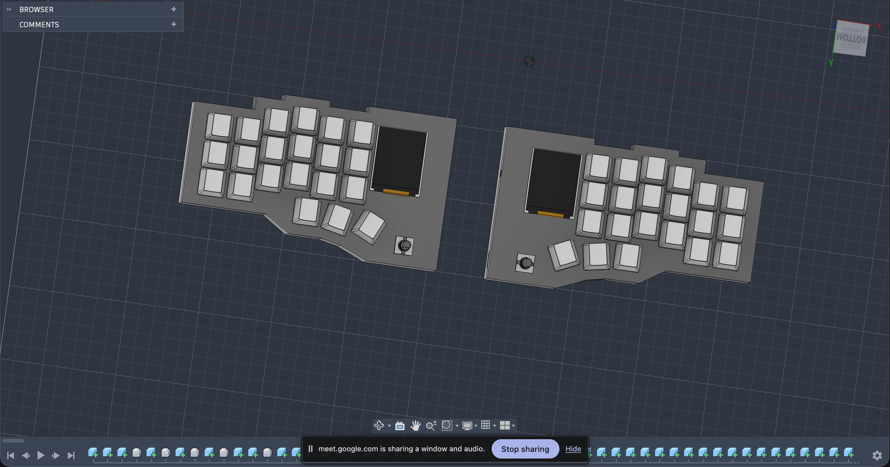
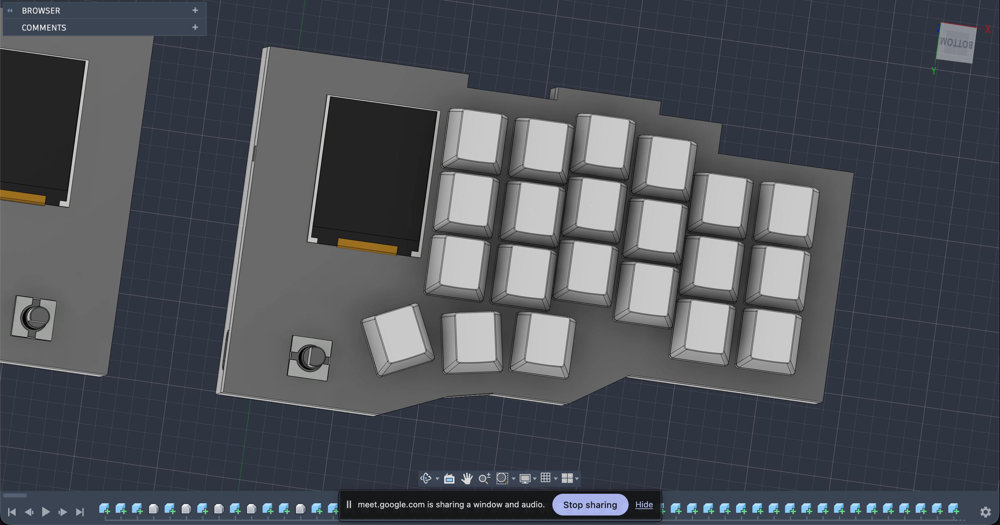
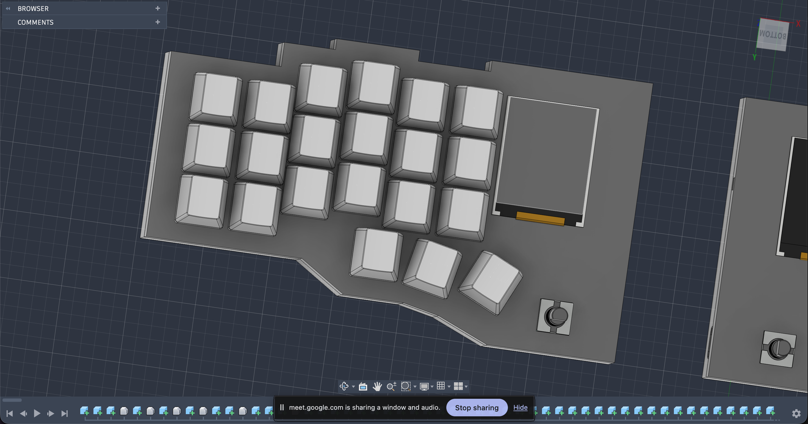

A wireless split mechanical keyboard featuring a 1.8" TFT display, an RC522 Mini RFID reader, and an EC11 rotary encoder. Powered by the ESP32-S3 microcontroller, this project utilizes direct-soldered Cherry MX switches and a custom 3D-printed sandwich-mount case secured with M3 heat-set inserts.
A project by Chronos made for Half Life  YSWS by Hack Club.

## Features & Hardware Design

### 21-Key Matrix & Backlighting
Each half features a 21-key matrix. Switches are soldered directly to the PCB for a lower bottom-case profile. Each key is paired with per-key RGB backlighting for fully customizable illumination.

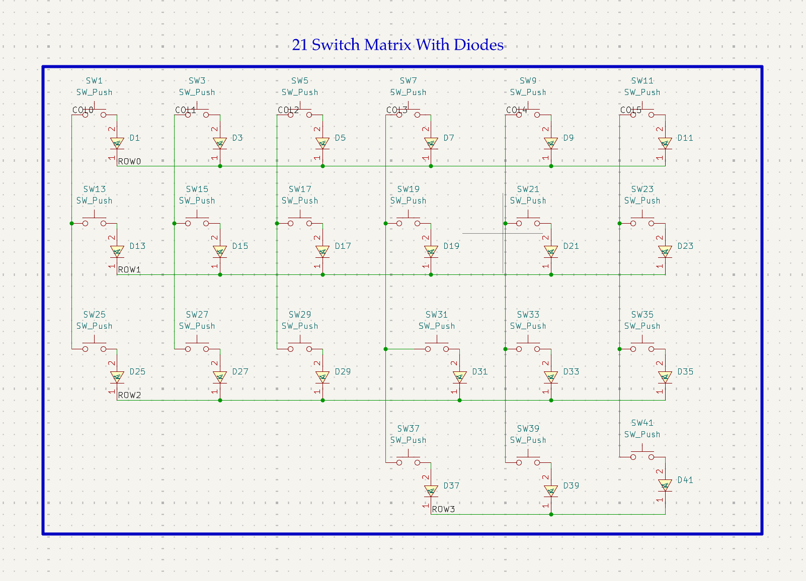

### Connectivity & Debugging
A USB Type-C port handles standard data and power, while dedicated J-Link headers are broken out for advanced firmware flashing and live debugging.
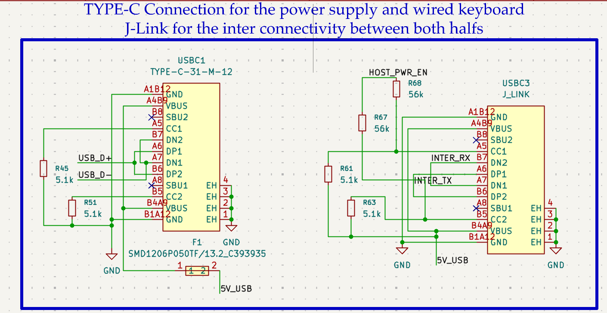

### Power & Battery
Integrated LiPo battery management (TP4056) for safe charging via USB-C, routed through a dedicated physical Power ON/OFF switch to conserve battery when traveling.
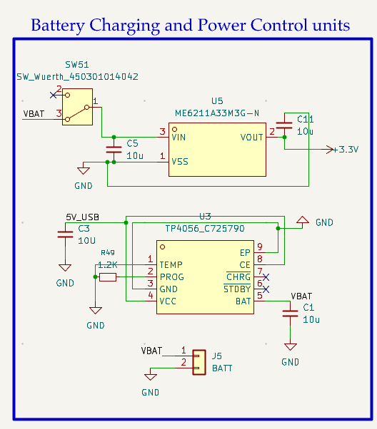

### Microcontroller (ESP32-S3)
The brain of the keyboard, handling wireless communication, matrix scanning, and peripheral management for each half.
* `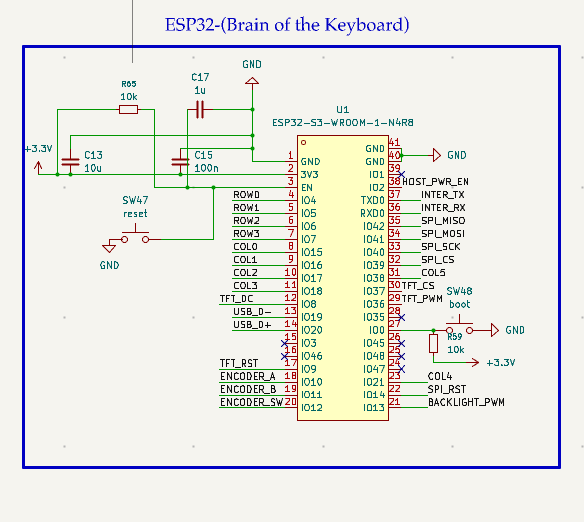

### Rotary Encoder
An EC11 rotary encoder for volume/media control. The built-in push button uses a hardware debounce circuit (10kΩ pull-up resistor and 100nF capacitor) for perfectly clean signal reads.

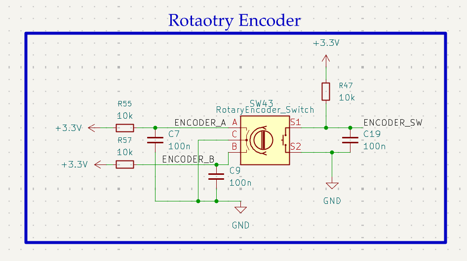

### NFC & Display Features
Integrated RC522 Mini RFID reader for NFC interactions (like secure unlocking) and a 1.8" TFT display for live system feedback, connectivity modes, and battery levels.

## Full Schematics & PCB Layout

* **Schematic - Left Half:** 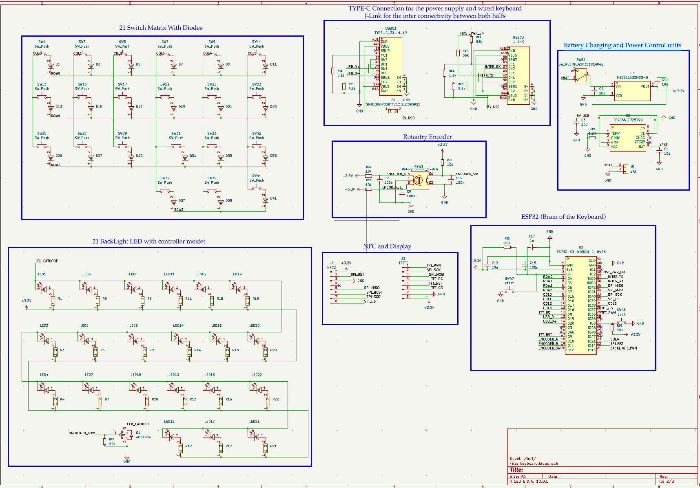
* **Schematic - Right Half:** 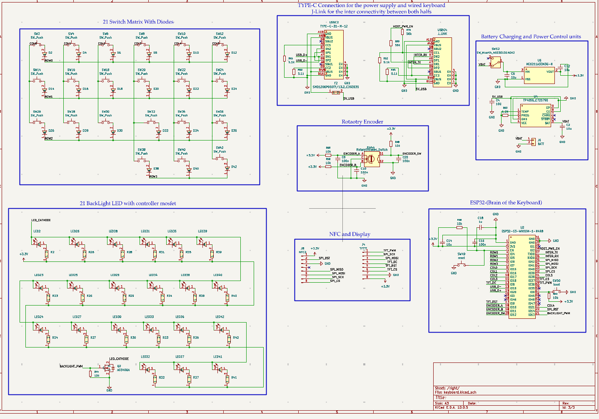
* **PCB Layout & Populated Board:** 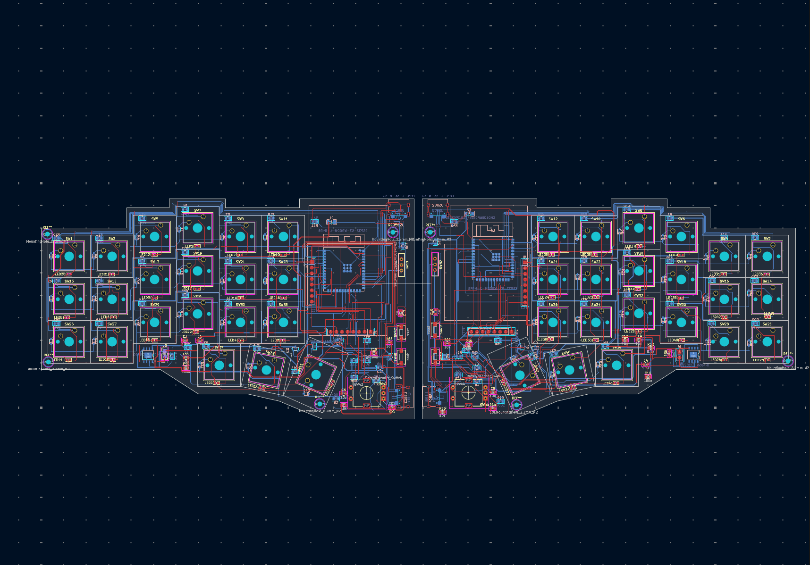

## Case Stack-up & CAD Dimensions

The case uses a custom 3D-printed top plate and bottom shell designed for standard Cherry MX desktop switches.

| Layer | Thickness / Dimension | Notes |
| :--- | :--- | :--- |
| **Top Plate** | 1.5 mm | Exact thickness required for Cherry MX side-clips to snap in securely. Features 14x14mm cutouts. |
| **Switch Gap** | 5.0 mm | Physical space between the bottom of the top plate and the top of the PCB. |
| **PCB** | 1.6 mm | Standard FR4 board thickness. |
| **Bottom Case Clearance** | 2.5 mm (Min) | Clearance required below the PCB to safely house soldered switch pins. |

**Mounting Hardware:** Secured using M3 brass heat-set inserts melted into the bottom case bosses (CAD hole diameter: 4.0mm, extruded 1mm deeper than the insert length) and standard M3 screws.

## Firmware

**Note: The firmware is made by Ai and  currently in development and has not yet been approved or fully tested. We will update this repository with the finalized firmware files and flashing instructions once the physical hardware is fully assembled and ready.It's my promise i will hand coded firmware and the best firmare once the keybaord will be complete in real**

## Bill of Materials

| Part | Description | Qty | Unit Cost | Total Cost | Vendor |
| :--- | :--- | :--- | :--- | :--- | :--- |
| ESP32-S3-WROOM-1 Module | MCU | 2 | $4.37 | $8.74 | [Robu.in](https://robu.in/product/espressif-esp32-s3-wroom-1-n16r8-module/) |
| Rotatory encoder | Volume and brightness control | 2 | $0.64 | $1.28 | [Robu.in](https://robu.in/product/360-degree-rotary-encoder-module/) |
| NFC RFID Reader | For the device unlocking | 2 | $1.44 | $2.88 | [IndianHobbycenter](https://www.indianhobbycenter.com/products/rc522-mini-rfid-reader-writer-spi-s50-with-rfid-card-and-tag?variant=41430763667499) |
| 10000mAh 3.7V Micro LiPo Battery | Power Source | 2 | $12.29 | $24.58 | [Robu.in](https://robu.in/?post_type=product&s=10000mAh+3.7V+Lipo) |
| TP4056 IC | Charging IC | 2 | $2.00 | $4.00 | [Ktron](https://www.ktron.in/product/tp4056-ic/#&gid=1&pid=1) |
| ME6211C33M5G | Regulators | 2 | $0.08 | $0.16 | [Robu.in](https://robu.in/product/me6211c33m5g-n-microne-500ma-fixed-3-3v-positive-electrode-6v-sot-23-5-voltage-regulators-linear-low-drop-out-ldo-regulators-rohs/) |
| AO3400A-HUASHUO | LED Mosfet | 2 | $0.06 | $0.12 | [Robu.in](https://robu.in/?post_type=product&s=AO3400A) |
| SMD1206B050TF | Fuse | 1 | $0.05 | $0.05 | [Robu.in](https://robu.in/product/1206l050yr-littelfuse-1206l050yr-resettable-fuse-pptc-1206-3216-metric-polyswitch-1206l-series-6-vdc-500-ma-1-a-0-1-s/) |
| TYPE-C | Charging and interconnection | 4 | $0.27 | $1.08 | [Robu.in](https://robu.in/?post_type=product&s=Type+C+Connector) |
| 1N4148WS | Diodes | 50 | $0.12 | $6.00 | [Robu.in](https://robu.in/?post_type=product&s=1N4148WS) |
| LED | Backlight | 50 | $0.01 | $0.50 | [Ktron.in](https://www.ktron.in/?post_type=product&s=0805+White+LED) |
| Resistor | Led Protection And other things | 60 | $0.01 | $0.60 | [Ktron.in](https://www.ktron.in/?post_type=product&s=0805+Resistor) |
| Capacitors | for the component electrical stability | 30 | $0.01 | $0.30 | [Ktron](https://www.ktron.in/product/resistor-30k-ohms-1-1-8w-smd-0805/) |
| Gateron Oil King | Switches | 5 | $2.58 | $12.90 | [Meckeys](https://meckeys.com/shop/accessories/keyboard-accessories/key-switches/akko-v3-pro-cream-black-switch/) |
| PCB | Component Housing | 1 | $45.00 | $45.00 | [Zbotic](https://zbotic.in/pcb-manufacturing/) |
| Case | housing of all electronics | 1 | $20.00 | $20.00 | [Printing legion](https://www.google.com/search?q=Printing+Legion+3D+printing) |
| 1.8 TFT display | Display | 2 | $3.19 | $6.38 | [Robu.in](https://robu.in/product/smartelex-1-8-tft-display-128x160/) |
| Slide Switch | Power Control | 2 | $0.12 | $0.24 | [Ktron.in](https://www.ktron.in/?post_type=product&s=Slide+Switch) |
| smdswitches | rebbot and flash | 1 | $0.21 | $0.21 | [MakerBAzar](https://makerbazar.in/products/micro-tactile-tact-keys-tasten-smd-push-side-button-schalter) |
| **Grand Total** | | | | **$135.02**| |